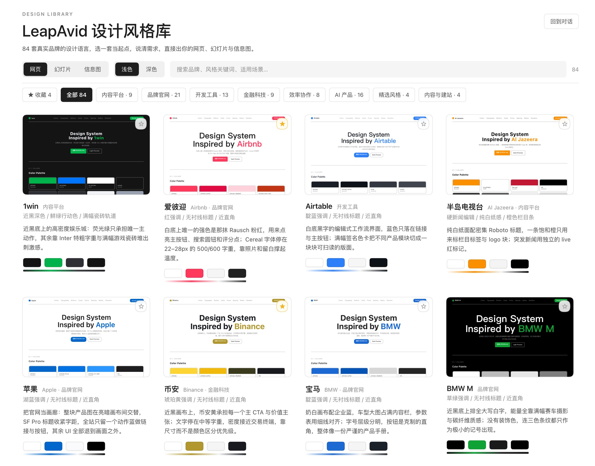

# DSH-Design-LeapAvid · LeapAvid 设计风格库

> 插件名 `DSH-Design-LeapAvid`，中文名「LeapAvid 设计风格库」；安装标识为 npm 包名 / cordis 条目 id `dsh-design-leapavid`（1.35.0 起从旧标识 `dsh-design-md` 整体迁移，浏览器里旧的收藏与最近使用记录会自动兼容读取）。

84 套品牌设计语言，在 DSH 左侧栏以「设计风格库」面板浏览。挑一套最接近的，写清楚要做什么，就把这套风格的完整 token 与交付规范送进当前会话，由 DSH 生成**网页、幻灯片或信息图**。

语料来自 [getdesign.md](https://getdesign.md/) 的开源库 [VoltAgent/awesome-design-md](https://github.com/VoltAgent/awesome-design-md)（MIT），每个风格都是一份可被模型直接执行的 `DESIGN.md`；中文文案、预览渲染器与面板 UI 由本项目原创。

## 界面

**列表页** —— 84 张卡片按宽度自适应 2–5 列，缩略图是各风格自己的 token 现场渲染（进入视口才渲染，其余为双色骨架）。顶栏切换 网页 / 幻灯片 / 信息图 与 浅色 / 深色，分类筛选带数量，卡片右上角可收藏。



**内容页** —— 标题旁显示「上次生成过 · 7 分钟前 · 3457 字」；左侧是完整参考页（可滚、锚点可跳转），右侧是生成表单：产出形态 / 用途、图表与版式 / 比例 / 密度（信息图），再往下是「适合 · 避免」「设计要点」和「规范明细」——配色 / 排版要求 / 形状与间距 / 组件样例 / 导出 token 五个切换按钮收起长表格，右栏高度从 3300px 降到 2000px 以内。


**信息图**（在同一面板切换即可看到）—— 同一套 token 投影到 4 种版式（一 / 两 / 三 / 四栏）× 5 种比例（1:1 / 4:3 / 3:4 / 16:9 / 9:16）× 2 种密度（紧凑 / 标准）上；图表从 6 种里选（自动 / 柱状 / 折线 / 环形 / 面积 / 漏斗），四栏模板自带迷你图。列表页在信息图载体下，缩略图就是四栏 16:9。

**幻灯片** —— 16:9，5 页一套（封面 / 主张 / 目录 / 数字 / 速览），版式沿用编辑部 deck 的语汇：细边框、等宽小字元信息、超大品牌字、强调色实底板块。

## 功能

| 区域 | 能力 |
| --- | --- |
| 左侧栏 | 「设计风格库」入口，点开切到主面板；`design_md` 工具可供 Agent 自己按风格生成 |
| 风格网格 | 84 张卡片，2–5 列自适应；搜索（名称 / 关键词 / 场景 / 标签）、8 个分类筛选（分类名后带数量）+「全部 84」+「★ 收藏 n」+「最近使用 n」；工具栏切换 网页 / 幻灯片 / 信息图 与 浅色 / 深色；缩略图 `IntersectionObserver` 懒渲染（切载体只重建首屏 8 张） |
| 实时预览 | **网页**：完整参考页，八段区块整页直出，导航 8 个锚点可点击跳转；**幻灯片**：16:9 五页一套；**信息图**：一栏 / 两栏 / 三栏 / 四栏 × 1:1 / 4:3 / 3:4 / 16:9 / 9:16 × 紧凑 / 标准；全部由该风格自己的 token 现场渲染（无截图、无 iframe、无外部资源），深浅两套底色可切换（深色品牌本身无浅色版） |
| 风格详情 | 标题旁显示「上次生成过 · 7 分钟前 · 信息图 · 3457 字」（跨载体时会标出上次的载体）；设计要点、配色板（点色块复制 hex）、字体层级、圆角与间距、适合 / 避免、AI 检查项、推荐提示词；底部「相近的风格」按明暗 / 色相 / 圆角 / 间距 / 字体距离取最近的 4 个，点一下就切过去 |
| 生成表单 | 产出形态（网页 / 幻灯片 / 信息图）；网页与幻灯片共享「用途」预设（网页：不限 / 落地页 / 定价页 / 控制台 / 博客；幻灯片：不限 / 标准 deck / 提案 deck / 汇报 deck / 产品 deck / 融资 deck / 培训 deck，选中后显示五页结构与适用场合）；信息图另有 图表 / 版式 / 比例 / 信息块密度；幻灯片与信息图各有「密度」三档。下方写明该载体会产出什么文件，发送后出现「再改一版 / 换风格重做」 |
| 导出 token | 复制 CSS 变量、下载 `tokens.json`（W3C 格式）、复制 Tailwind `theme.extend` 片段 |
| Agent 工具 | `design_md`：`list` 检索风格、`get` 读取某风格的 token 与要点（可带完整 DESIGN.md） |
| HTTP 接口 | `/api/design-md/*`：catalog / style / brief / design / prompt / health，供面板与外部复用；`POST /prompt` 对未知 `surface` 返回 400 |

### 三种载体的产出

| 载体 | 产物 | 说明 |
| --- | --- | --- |
| 网页 | `index.html` | 单文件、CSS/JS 内联、无外链资源，内置亮/暗两套 token，带打印样式 |
| 幻灯片 | `deck.html` | 16:9 满屏分页，每套 5 页，← → 翻页，自带打印 / 导出 PDF |
| 信息图 | `index.html` | 单文件，按所选版式、比例与密度排版，含所选图表 |

## 安装

插件是标准 DSH bundle，三种装法都可用（1.36.4 已发布到 npm）：

```text
# 1) 本地目录（开发 / 自用）
plugin_manager action=install_bundle target=<本目录绝对路径>

# 2) GitHub 源（仓库已公开，锁定 release tag）
plugin_manager action=install_bundle target=github:magiccyclingz/dsh-design-leapavid#v1.36.4

# 3) npm（已发布，latest = 1.36.4）
plugin_manager action=install_bundle target=dsh-design-leapavid
```

安装后左侧栏出现「设计风格库」。改动 `client.js` 只需刷新页面；改动 `index.js` 需要重新加载插件条目：

```text
plugin_manager action=set_plugin target=include:dsh-design-leapavid enabled=false
plugin_manager action=set_plugin target=include:dsh-design-leapavid enabled=true
```

## 数据管线

```bash
node build/build-data.mjs      # 产出 data/catalog.json + data/design/<slug>.md + data/brief/<slug>.md
```

- 输入：上游 `awesome-design-md-main/design-md/<slug>/DESIGN.md`（84 个，MIT）+ 本仓库自建的 `build/zh-lexicon.json`（品牌名与分类标签）。主库默认按「与本仓库同级」查找，可用 `DESIGN_MD_MAIN` 环境变量指向别处。
- 解析两种语料：带 YAML front matter 的 token 表，以及纯 Markdown 文档（从正文配对 `#hex`、排版表格、`Radius: Npx` 提取）。
- `buildVisual()` 推导视觉参数（accent / canvas / ink / muted / hairline、深色版、字体栈、字号字距、圆角、间距基准），再由 `sanitizeVisual()` 收口：字号 30–112、行高换算为比例、tracking 限幅、次要文字对比 ≥3.1、accent 对底色 ≥2.1、字体栈补通用族回退。
- `buildBrief()` 生成 ≤2KB 的风格要点（氛围 + 版式 + 形状 + 该做 + 避免），并清洗 Markdown 残渣与重复 hex。
- 10 个主库独有风格（1win、aljazeera、dji、jobright、mercury、mydealz、nerdwallet、oracle、oura、sap）的中文元数据在 `build/extra-metadata.json`；视觉推导的手工修正放在 `build/overrides.json`。

### 信息图怎么吃 token

信息图不另建主题：配色来自 `themeOf(style)`，字体来自 `visual.displayStack`，圆角 / 间距 / 标题字号 / 字距 / 行高来自 `visual.radiusCard`、`visual.spaceBase`、`visual.displaySize`、`visual.displayTracking`、`visual.displayLineHeight`。间距按 `clamp(0.85, spaceBase / 8, 1.35)` 缩放，避免两倍基准的品牌（如间距基数 16px）把画布撑破。

## 结构

```text
index.js              Host：HTTP 路由 + design_md 工具 + 提示词组装
client.js             Client：slots 注册（sidebar.panellist / main）+ 面板 UI + 预览渲染器（含 `STRINGS.zh/en` 全部界面文案）
locale/zh.json|en.json  插件元信息（name / description），界面文案在 client.js
data/catalog.json       84 条风格数据（token、视觉参数、中文元数据）
data/design/<slug>.md   原始 DESIGN.md 副本
data/brief/<slug>.md    风格要点摘要
docs/                   截图、发布清单、市场条目草稿
build/                  数据构建脚本与覆盖表（开发用，不进 npm 包）
```

## 边界

- 品牌字体（Sohne、Copernicus、SF Pro 等）不随插件分发，预览按 sans/serif/mono 回退到系统字体；风格差异靠字号、字重、字距、层级与密度表达。
- 预览里的文案与数字是示意内容，用来展示排版气质，不代表真实项目数据。
- 生成消耗你自己的模型额度；插件本身只读，不写工作区。
- **海报（poster）暂时下线**：渲染链路（`posterHtml`、`ART_BUILDERS.poster`、宿主 `surface=poster`）保留在代码里，但不在 UI 暴露；恢复时把 `client.js` 的 `STRING_SURFACES` 加回 `poster: true` 即可。

## 测试

```bash
npm test          # 27 项：宿主路由与 store 接口、catalog 完整性、提示词组装与边界
node --check index.js && node --check client.js
```

## 许可与归属

- 本项目以 MIT 发布，见 [LICENSE](./LICENSE)。
- `data/design/<slug>.md` 的 84 份 DESIGN.md 原文来自 [VoltAgent/awesome-design-md](https://github.com/VoltAgent/awesome-design-md)（MIT，© 2026 VoltAgent），版权声明与许可全文见 [THIRD-PARTY-NOTICES.md](./THIRD-PARTY-NOTICES.md)。
- `data/brief/`、中文文案、预览渲染器与面板 UI 为本项目原创。

## 免责声明

本项目与 Apple、Stripe、Airbnb、BMW、Figma 等被分析的品牌**没有关联、合作或授权关系**，品牌名称仅用于指代其公开的设计语言。仓库不含品牌字体、商标图形或官网截图，所有预览均由 token 现场渲染。若相关品牌方认为某条描述不妥，可通过 issue 要求下架该条目。

## 发布与上架

npm 包 **`dsh-design-leapavid@1.36.4`** 已发布（`npm i -D dsh-design-leapavid`）；仓库已于 2026-11-18 转为 **public**：<https://github.com/magiccyclingz/dsh-design-leapavid>，发布流程、npm 发布前检查与市场条目字段见 [docs/RELEASE.md](./docs/RELEASE.md)；市场条目见 [docs/market-entry.json](./docs/market-entry.json)（npm 源变体：`docs/market-entry.npm.json`）。
