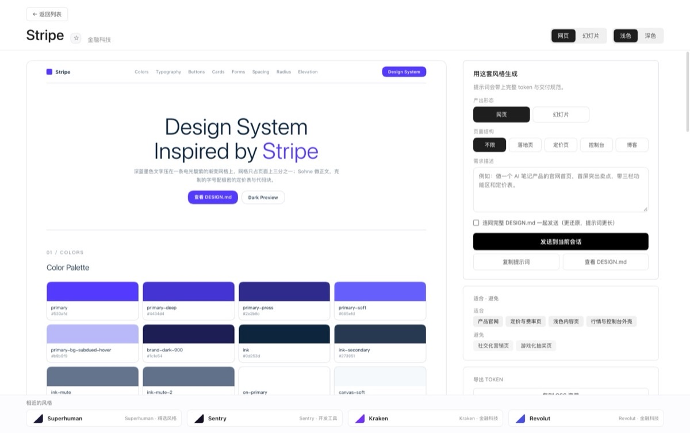
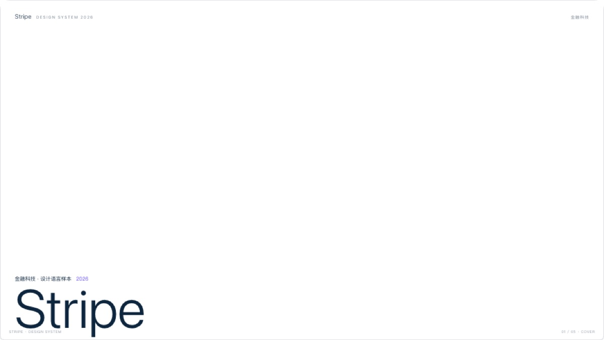
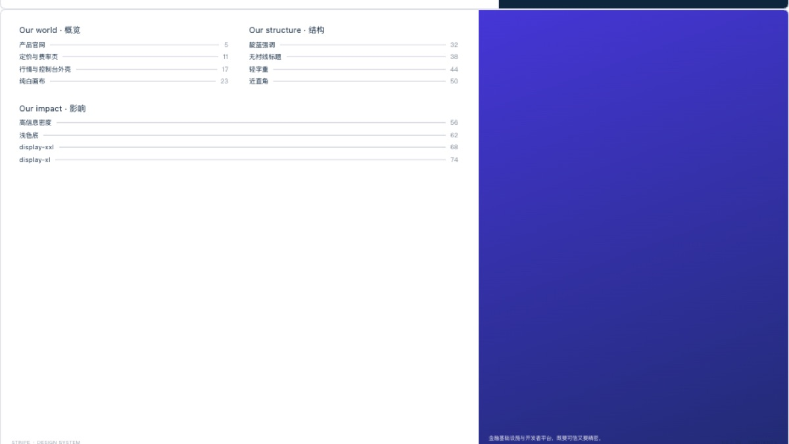
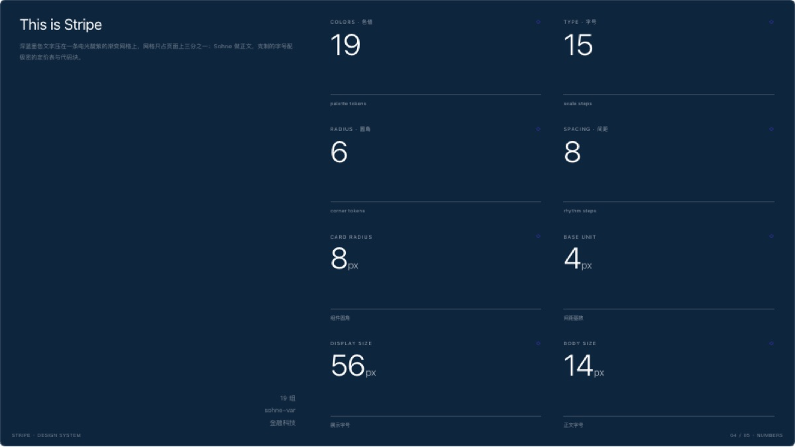

# dsh-design-md

84 套品牌设计语言，在 DSH 左侧栏以「设计风格库」面板浏览；选中任意风格，写下需求，一键把风格 token 送进当前会话，由 DSH 生成网页或幻灯片。

语料来自 [getdesign.md](https://getdesign.md/) 的开源库 [VoltAgent/awesome-design-md](https://github.com/VoltAgent/awesome-design-md)（MIT），每个风格都是一份可被模型直接执行的 `DESIGN.md`；中文文案由本项目依据各风格的 token 自行生成。

## 界面

**列表页** —— 84 张卡片按宽度自适应 3–5 列，卡片预览是各风格自己的 token 现场渲染；顶部可切换 网页 / 幻灯片 与 浅色 / 深色，第一颗 chip 是收藏夹。


**内容页** —— 左侧是完整参考页（可滚、锚点可跳转），右侧依次是生成表单、适合·避免、设计要点、配色、排版要求、形状与间距、组件样例、导出 token；底部是相近的风格。



**幻灯片** —— 16:9，5 页一套（封面 / 主张 / 目录 / 数字 / 速览），版式沿用编辑部 deck 的语汇：细边框、等宽小字元信息、超大品牌字、强调色实底板块、圆角工程图。下面是其中三页（Stripe 这套）：







## 功能

| 区域 | 能力 |
| --- | --- |
| 左侧栏图标 | 「设计风格库」入口，点开切到主面板 |
| 风格网格 | 84 张卡片，3–5 列自适应；搜索（名称 / 关键词 / 场景 / 标签）、8 个分类 +「全部」筛选；工具栏可切换 网页 / 幻灯片 两种形态与 浅色 / 深色；卡片右上角星标收藏，chips 前置「★ 收藏 N」「最近 N」两个视图；预览按需懒渲染（首屏只画 8 张，其余为双色骨架） |
| 实时预览 | 网页（完整参考页，八段区块整页直出，导航 8 个锚点可点击跳转）/ 幻灯片 16:9（5 页一套）；两种载体都可切换浅色 / 深色（深色品牌本身无浅色版）；全部由该风格自己的 token 现场渲染（无截图、无 iframe、无外部资源） |
| 风格详情 | 设计要点、配色板（点色块复制 hex）、字体层级、圆角与间距、适合 / 避免、AI 检查项、推荐提示词；底部「相近的风格」条（按明暗 / 色相 / 圆角 / 间距 / 字体距离取最近的 4 个，点一下就切过去） |
| 生成表单 | 产出形态（网页 / 幻灯片），幻灯片另有「密度」三档（宽松 / 标准 / 信息密集，对应不同字号与每页信息块上限，deck 内置浅深双主题与切换按钮），页面结构预设随载体切换（网页：不限 / 落地页 / 定价页 / 控制台 / 博客；幻灯片：不限 / 标准 deck / 提案 deck / 汇报 deck / 产品 deck / 融资 deck / 培训 deck，选中后显示该套的五页结构与适用场合说明）+ 需求 +（可选）附带完整 DESIGN.md；表单下方写明该载体会产出什么，配色色盘放大到 44px；发送后出现「再改一版 / 换风格重做」 |
| 导出 token | 复制 CSS 变量、下载 `tokens.json`（W3C 格式）、复制 Tailwind `theme.extend` 片段 |
| Agent 工具 | `design_md`：`list` 检索风格、`get` 读取某风格的 token 与要点，让模型自己按风格生成 |
| HTTP 接口 | `/api/design-md/*`：catalog / style / brief / design / prompt，供面板与外部复用 |

## 安装

插件是标准 DSH bundle，用 Host 的插件管理器安装目录即可：

```text
plugin_manager action=install_bundle target=<本目录绝对路径>
```

安装后左侧栏出现「设计风格库」。改动 `client.js` 只需刷新页面；改动 `index.js` 需要重新加载插件条目：

```text
plugin_manager action=set_plugin target=include:dsh-design-md enabled=false
plugin_manager action=set_plugin target=include:dsh-design-md enabled=true
```

## 数据管线

```bash
node build/build-data.mjs      # 产出 data/catalog.json + data/design/<slug>.md + data/brief/<slug>.md
```

- 输入：上游 `awesome-design-md-main/design-md/<slug>/DESIGN.md`（84 个，MIT）+ 本仓库自建的 `build/zh-lexicon.json`（品牌名与分类标签）。主库默认按「与本仓库同级」查找，可用 `DESIGN_MD_MAIN` 环境变量指向别处；中文描述由 `build/build-data.mjs` 依据 token 生成，不读取任何第三方中文文本。
- 解析两种语料：带 YAML front matter 的 token 表，以及纯 Markdown 文档（从正文配对 `#hex`、排版表格、`Radius: Npx` 提取）。
- `buildVisual()` 推导每个风格的视觉参数（accent / canvas / ink / muted / hairline、深色版、字体栈、字号字距、圆角、间距基准），再由 `sanitizeVisual()` 收口：字号 30–112、行高换算为比例、tracking 限幅、次要文字对比 ≥3.1、accent 对底色 ≥2.1、字体栈补通用族回退。
- `buildBrief()` 生成 ≤2KB 的风格要点（氛围 + 版式 + 形状 + 该做 + 避免），并清洗 Markdown 残渣与重复 hex。
- 10 个主库独有风格（1win、aljazeera、dji、jobright、mercury、mydealz、nerdwallet、oracle、oura、sap）的中文元数据在 `build/extra-metadata.json`；视觉推导的手工修正放在 `build/overrides.json`。

## 结构

```text
index.js              Host：HTTP 路由 + design_md 工具 + 提示词组装
client.js             Client：slots 注册（sidebar.panellist / main）+ 面板 UI + 预览渲染器
locale/zh.json|en.json  面板文案与插件元信息
locale/detail.*.md      插件详情页说明
data/catalog.json       84 条风格数据（token、视觉参数、中文元数据）
data/design/<slug>.md   原始 DESIGN.md 副本
data/brief/<slug>.md    风格要点摘要
build/                  数据构建脚本与覆盖表（开发用，不进 npm 包）
```

## 边界

- 品牌字体（Sohne、Copernicus、SF Pro 等）不随插件分发，预览按 sans/serif/mono 回退到系统字体；风格差异靠字号、字重、字距、层级与密度表达。
- 预览里的文案是示意内容，用来展示排版气质，不代表真实项目文案。
- 生成消耗你自己的模型额度；插件本身只读，不写工作区。

## 许可与归属

- 本项目以 MIT 发布，见 [LICENSE](./LICENSE)。
- `data/design/<slug>.md` 的 84 份 DESIGN.md 原文来自 [VoltAgent/awesome-design-md](https://github.com/VoltAgent/awesome-design-md)（MIT，© 2026 VoltAgent），版权声明与许可全文见 [THIRD-PARTY-NOTICES.md](./THIRD-PARTY-NOTICES.md)。
- `data/brief/`、中文文案、预览渲染器与面板 UI 为本项目原创。

## 免责声明

本项目与 Apple、Stripe、Airbnb、BMW、Figma 等被分析的品牌**没有关联、合作或授权关系**，
品牌名称仅用于指代其公开的设计语言。仓库不含品牌字体、商标图形或官网截图，所有预览均由 token 现场渲染。
若相关品牌方认为某条描述不妥，可通过 issue 要求下架该条目。
