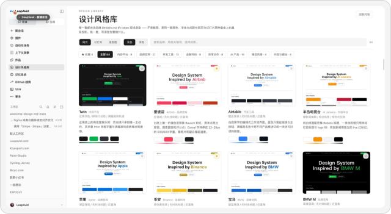

# DSH-Design-LeapAvid

Eighty-four brand design languages taken from the open awesome-design-md corpus (MIT). Each style is drawn live from that brand's own `DESIGN.md` — colours, type, radii and spacing — inside the panel: no screenshots, no external assets.

## What it does

- **Browse**: 84 cards over three carriers — web page (16:9), slide deck (16:9, five pages per style) and infographic (4:3 cover). Thumbnails render only as they scroll into view, so long lists stay smooth. Search matches brand name, Chinese name, slug, keywords and use cases; category chips carry counts (All 84, Brand sites 21, AI products 16 …); “★ Favourites” and “Recent” are one click away.
- **Inspect**: the right rail's *Specs* card holds five switches — palette (click a swatch to copy its hex), type, shape & spacing, component samples, and token export (copy CSS custom properties, download a W3C `tokens.json`, or copy a Tailwind `theme.extend` snippet). Below sits a “similar styles” strip, a star toggle, and a badge showing the last generation (“last generated · N min ago · N chars”).
- **Generate**: pick the carrier, describe the work, and the panel composes a prompt (tokens + style notes + delivery rules) into the current conversation, so DSH writes a single `index.html` (web), `deck.html` (slides) or an infographic HTML. Decks also take a purpose (standard / pitch / report / product / fundraising / training) and a three-step density; infographics take a chart type (auto / bar / line / donut / area / funnel), a layout (1–4 columns), a canvas ratio (1:1 / 4:3 / 3:4 / 16:9 / 9:16) and block density. Attaching the full `DESIGN.md` is optional; after sending, the form offers “iterate” and “redo with another style”.
- **Agent tool**: `design_md` (`list` / `get`) lets the model search the same library on its own.

## Favourites, recents and last generation

All three live on the **host**: `$DSH_HOME/dsh-design-leapavid/store.json`, read and written through `GET|POST /api/design-md/store`. The desktop app picks a new port on every launch, which changes the origin, so this keeps favourites and recents across restarts. Browser `localStorage` is only a cache and the seed for the first migration (the legacy `dsh-design-md:v1` key is read automatically).

## Data

- Source: `awesome-design-md-main/design-md/<slug>/DESIGN.md` (84 styles, MIT)
- Chinese copy: generated in this repo — `build/zh-lexicon.json` (brand names, category labels) + `build/copy-overrides.json` (84 hand-written summaries and positioning lines); no third-party Chinese text is copied
- Built artifacts in `data/`: `catalog.json`, `design/<slug>.md`, `brief/<slug>.md`

Rebuild with `node build/build-data.mjs`.

## Structure

- `index.js` (host): `/api/design-md/{catalog,style/<slug>,brief/<slug>,design/<slug>,prompt,store}` plus the `design_md` tool. Read-only apart from the store; never writes to the workspace.
- `client.js` (client): registers the `sidebar.panellist` icon and the `main` panel; the panel is React rendered with `--dsw-alias-*` theme tokens; sending goes through `sessions.binding(id).session.prompt()` into the current conversation.
- Previews use CSS container queries (`cqw`), so the same renderer holds up in a 250px card and a full-width detail frame.

## Known limits

- Brand fonts (Sohne, Copernicus, SF Pro …) are not bundled; previews fall back to system sans/serif/mono and rely on size, weight, tracking and density to convey the style.
- Preview copy is placeholder content, not real project copy.
- The poster carrier (4:5) is rendered and has its prompt path, but the entry is hidden until its layout set is final.
